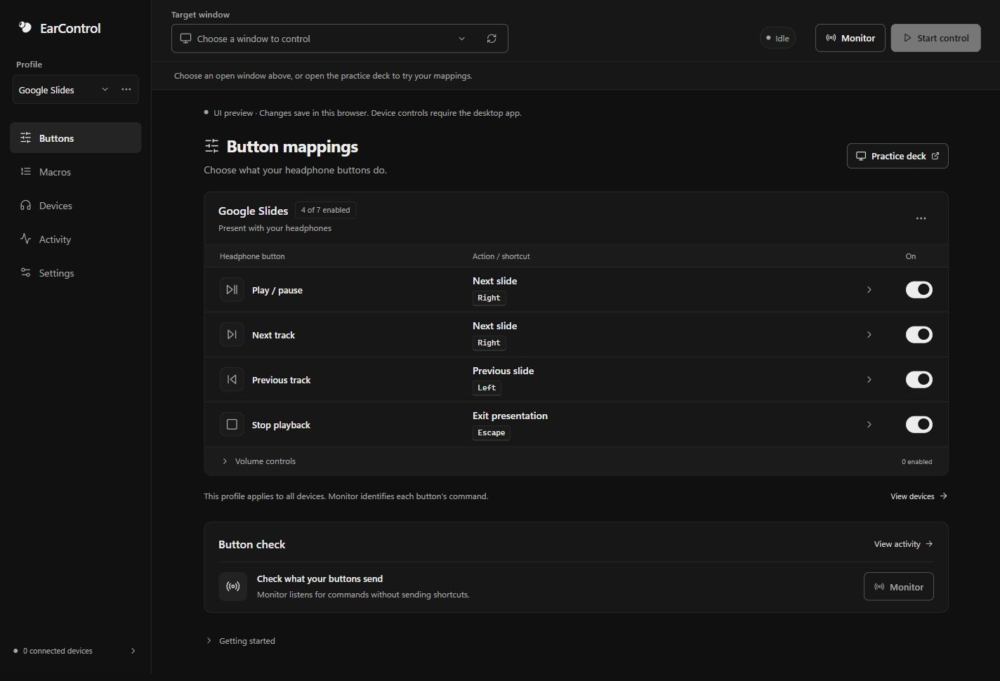

# EarControl

Map headphone media commands to Windows shortcuts and macros.

https://github.com/user-attachments/assets/53dbceda-f306-42fe-b55f-9e94693331cb

[Download the 20-second demo](https://github.com/aasmanbashyal/earcontrol/raw/refs/heads/main/docs/media/earcontrol-demo.mp4) · [User guide](docs/user-guide.md) · [Development](CONTRIBUTING.md) · [Support](SUPPORT.md)

EarControl lets a supported headphone command advance a slide, run a shortcut, or execute an ordered macro. Use Monitor to see what Windows receives, choose a profile and target window, then start control.

## Get started

Version **2.1.2** has Windows installer and portable builds. Published downloads appear on the [Releases page](https://github.com/aasmanbashyal/earcontrol/releases). Before publication, signed-in GitHub users can open a successful [Windows build](https://github.com/aasmanbashyal/earcontrol/actions/workflows/windows.yml) and download its `EarControl-windows-x64` artifact.

- **Installer:** `EarControl_2.1.2_x64-setup.exe`, for a per-user installation.
- **Portable:** extract `EarControl-2.1.2-win-x64.zip` and open `EarControl.exe`.

Windows 10/11 x64 and Microsoft Edge WebView2 Runtime are required. The installer checks the runtime. No Rust or .NET installation is needed to run the app. These binaries are unsigned. Downloads include a SHA-256 checksum manifest. Release binaries stay outside Git.

1. Pair headphones with the PC in Windows Bluetooth settings.
2. Open **Monitor** and try each gesture. Activity shows the command received.
3. Choose a profile and target window, or open the **Practice deck**.
4. Click **Start control**, then focus the target window.
5. Click **Stop** to cancel control and any running macro. Closing stops capture; minimizing keeps it running.

## Make the buttons useful

Google Slides and PowerPoint profiles start with these mappings:

| Command | Shortcut | Action |
| --- | --- | --- |
| Play / pause | Right | Next slide |
| Next track | Right | Next slide |
| Previous track | Left | Previous slide |
| Stop playback | Escape | Exit presentation |

Create profiles for other apps. Macros combine **Shortcut**, **Delay**, and **Text** steps, with a countdown before testing and cancellation on Stop or target-focus loss. The practice deck provides slide navigation and a text field for checking mappings. Light, dark, and system themes share the same neutral controls.



Windows controls which media session receives headphone events. Pause competing media apps if Monitor stays empty. Events do not identify the earbud side, tap count, or individual headset. The device list is informational; physical compatibility depends on the headphones and driver. See [headphone support](docs/user-guide.md#headphone-support).

## Build and contribute

Install the prerequisites in [CONTRIBUTING.md](CONTRIBUTING.md), then run from the repository root:

```powershell
bun run setup
bun run dev
bun run test
bun run package
bun run release:verify
```

The app uses Tauri 2, Rust, React, and TypeScript. Windows automation lives in `scripts/windows.ps1`; the root Bun commands are its public interface. [Architecture](docs/architecture.md) explains the source boundaries. [Releasing](docs/releasing.md) explains version checks, draft releases, and distribution checks.

See the [changelog](CHANGELOG.md) for changes and [demo source and credits](media/launch/README.md) for the illustrated walkthrough. The demo uses the actual browser UI and keyboard-driven practice states; it does not show a physical headphone test.

Application source is [MIT licensed](LICENSE). Demo audio retains the separate licenses listed in its credits.
